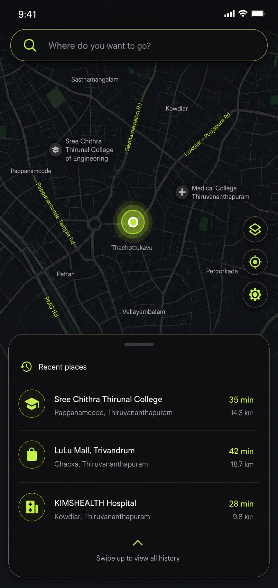
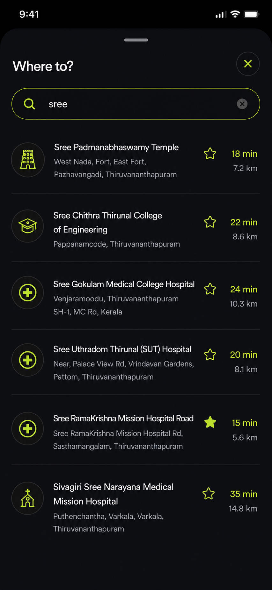
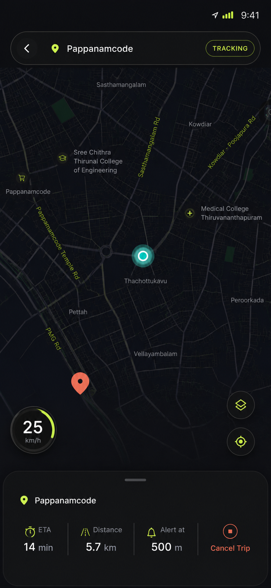
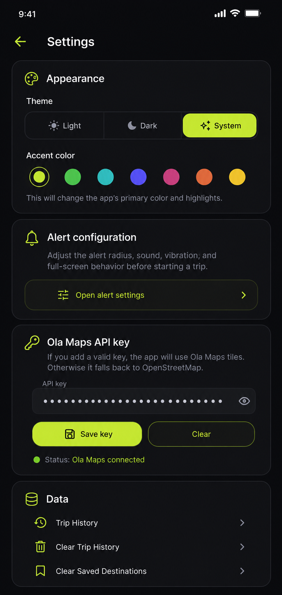
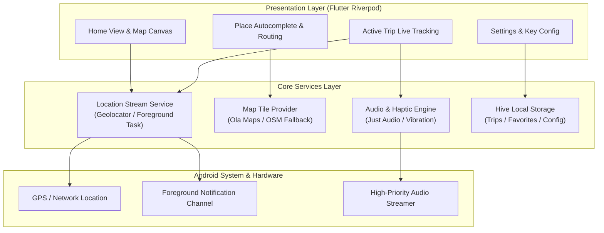

<div align="center">

# ⏰ WakeUP-Buddy
### Smart Location-Based Geofenced Alarm for Commuters

[](https://flutter.dev/)
[](https://dart.dev/)
[](https://riverpod.dev/)
[](https://maps.olakrutrim.com/)
[](https://www.android.com/)
[](LICENSE)

<p align="center">
  <b>Sleep peacefully on your daily commute.</b> WakeUP-Buddy tracks your real-time transit distance and fires persistent, unstoppable alarms before you reach your train, bus, or metro stop.
</p>

[The Problem](#-the-problem) •
[Key Features](#-key-features) •
[UI Showcase](#-ui-showcase) •
[Architecture](#-system-architecture) •
[Getting Started](#-getting-started) •
[Configuration](#-ola-maps-configuration)

</div>

---

## 🚇 The Problem

Every day, millions of commuters experience **transit anxiety** or overshoot their stops due to fatigue, reading, or falling asleep. Traditional alarms fail commuters because:
1. **Unpredictable Delays:** Traffic congestion, signals, and transit holds make standard time-based clock alarms useless.
2. **Silent Mode Failures:** Standard phone notifications get muted by DND (Do Not Disturb) or system volume settings.
3. **Battery Drain:** Continuous high-accuracy GPS polling drains the commuter's battery before their workday even begins.

### 💡 The Solution: WakeUP-Buddy
WakeUP-Buddy uses **intelligent distance-based geofencing** and **adaptive background location polling** to trigger critical high-priority audio alarms exactly when you enter your target radius—regardless of transit delays or silent mode.

---

## ✨ Key Features

| Feature | Description |
| :--- | :--- |
| 📍 **Dual-Geofence Proximity Engine** | Set customized trigger radii (e.g., 500m gentle pre-alert, 200m critical alarm) with live distance countdown. |
| 🗺️ **Ola Maps & OSM Integration** | Ultra-responsive map rendering with Ola Maps vector/raster tiles, autocomplete place search, and automatic OpenStreetMap fallback. |
| 🔊 **Override DND & Silent Mode** | High-priority audio stream using `just_audio` and `alarm` to guarantee audible wake-up alerts even when device is on mute. |
| 🔋 **Battery-Smart Location Engine** | Adaptive GPS polling frequency that increases precision only as you approach your destination, conserving battery over long journeys. |
| 🎨 **Fluid Material 3 Glassmorphism** | Polished Dark and Light mode interfaces with real-time ETA, route polyline preview, and haptic feedback. |
| 📴 **Offline-Resilient Storage** | Hive local database persistence for favorite destinations, past trips, and custom alarm tune preferences. |

---

## 📱 UI Showcase

<div align="center">

| Home Screen | Place Search & Routing | Active Trip Tracking | Settings & Audio |
|:---:|:---:|:---:|:---:|
|  |  |  |  |

</div>

---

## 🏗️ System Architecture

WakeUP-Buddy is built on **Flutter Riverpod** using feature-first modular architecture:



---

## 📂 Codebase Structure

```text
WakeUP-Buddy/
├── android/                     # Android native project configuration & manifests
├── assets/                      # Application assets
│   ├── images/                  # App branding & icons
│   └── sounds/                  # Emergency & gentle wake-up audio tones
├── docs/                        # Detailed architectural specifications
│   ├── 01-project-setup.md      # Flutter environment setup guide
│   ├── 02-theming-design.md     # Material 3 color tokens & styles
│   ├── 03-location-service.md   # Background geolocation implementation
│   ├── 04-map-integration.md    # Ola Maps API integration specification
│   ├── 05-destination-search.md # Autocomplete & geocoding logic
│   ├── 06-active-trip.md        # Real-time geofence calculation engine
│   └── 07-alarm-audio.md        # High-priority audio playback pipeline
├── lib/
│   ├── core/                    # Global constants, theme, and shared services
│   │   ├── constants/           # API routes, storage keys, style constants
│   │   ├── services/            # Map provider, audio manager, location stream
│   │   └── theme/               # Dark & Light glassmorphic design system
│   ├── features/                # Feature-driven business logic & UI
│   │   ├── home/                # Main dashboard & quick destination picker
│   │   ├── search/              # Search bar, recent places, Ola geocoding
│   │   ├── trip/                # Live tracking view, ETA calculation, progress bar
│   │   └── settings/            # Alarm volume, custom tones, API key override
│   └── main.dart                # App entrypoint & Riverpod initialization
├── screenshots/                 # Application preview screenshots
├── pubspec.yaml                 # Flutter package dependencies
├── analysis_options.yaml        # Strict Dart linter rules
└── README.md                    # Project documentation
```

---

## 🚀 Getting Started

### Prerequisites
* **Flutter SDK 3.10.0+**
* **Dart SDK 3.0.0+**
* **Android Studio / VS Code**
* **Android Device or Emulator** (API level 26+)

### 1. Clone the Repository
```bash
git clone https://github.com/your-username/WakeUP-Buddy.git
cd WakeUP-Buddy
```

### 2. Install Dependencies
```bash
flutter pub get
```

### 3. Run the App
```bash
# Run with default OSM map tiles:
flutter run

# Run with your Ola Maps API Key:
flutter run --dart-define=OLA_MAPS_API_KEY=your_ola_maps_key_here
```

---

## 🗺️ Ola Maps Configuration

WakeUP-Buddy supports **Ola Maps** raster & vector tile sets for India.

1. Create a developer account at [Ola Maps Portal](https://maps.olakrutrim.com/).
2. Generate your API Key.
3. Supply the key in one of two ways:
   * **In-App:** Open **Settings** ⚙️ $\rightarrow$ **Map Provider** $\rightarrow$ paste your API key.
   * **Compile-Time:** Pass `--dart-define=OLA_MAPS_API_KEY=your_key` during `flutter build` or `flutter run`.

> [!NOTE]
> If no Ola Maps API key is configured, WakeUP-Buddy **automatically switches to OpenStreetMap (OSM)** without crashing or interrupting trip navigation.

---

## 🔔 Android Permissions & Background Execution

To ensure alarms trigger when the screen is locked:
- `ACCESS_FINE_LOCATION` & `ACCESS_COARSE_LOCATION`
- `ACCESS_BACKGROUND_LOCATION`
- `FOREGROUND_SERVICE_LOCATION`
- `WAKE_LOCK`
- `USE_FULL_SCREEN_INTENT`
- `SYSTEM_ALERT_WINDOW`

These permissions are pre-configured in `android/app/src/main/AndroidManifest.xml`.

---

## 📄 License
This project is licensed under the MIT License - see the [LICENSE](LICENSE) file for details.
