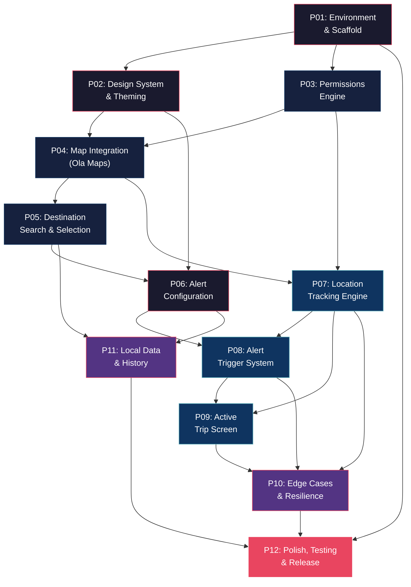

# 🗺️ WakeUp Buddy — Master Implementation Roadmap

> **Version:** Draft-1 · **Created:** 2026-05-24  
> **Target:** Android (API 29+, primary focus Android 12+) · Flutter 3.x · Dart 3.x  
> **Architecture:** On-device only (no server dependency)

---

## 📌 One-Line Summary

A smart location-based alarm app that ensures commuters never miss their stop by triggering vibration and sound alerts when they approach their destination.

---

## 🏗️ Phase Overview (12 Core Phases)

| # | Phase | Description | Est. Effort | Dependencies | Testable Deliverable |
|---|-------|-------------|-------------|--------------|----------------------|
| 01 | **Environment & Project Scaffold** | Flutter setup, project structure, CI lint | 1 day | — | `flutter run` shows branded splash |
| 02 | **Design System & Theming** | Colors, typography, dark/light, components | 1–2 days | P01 | Theme toggle works, design tokens visible |
| 03 | **Permissions Engine** | Location, notification, battery opt-out flow | 1 day | P01 | All permissions granted & persisted |
| 04 | **Map Integration (Ola Maps)** | flutter_map + Ola tiles + OSM fallback | 2 days | P02, P03 | Map renders, user location visible |
| 05 | **Destination Search & Selection** | Ola Autocomplete API + map pin drop | 2 days | P04 | User can search & select destination |
| 06 | **Alert Configuration** | Radius slider, sound picker, settings persistence | 1–2 days | P02, P05 | Settings saved & restored on relaunch |
| 07 | **Location Tracking Engine** | Foreground service, background isolate, GPS | 2–3 days | P03, P04 | Distance updates in real-time (foreground & background) |
| 08 | **Alert Trigger System** | Distance calc, vibration, audio, wake lock | 2 days | P06, P07 | Alarm fires at correct distance |
| 09 | **Active Trip Screen** | Live UI: distance, ETA, map tracking, cancel | 1–2 days | P07, P08 | Full trip lifecycle visible |
| 10 | **Edge Cases & Resilience** | GPS loss, overshoot, silent mode, battery | 2 days | P07, P08, P09 | Graceful handling of all failure modes |
| 11 | **Local Data & History** | Hive DB, recent destinations, trip history | 1–2 days | P05, P06 | Data persists across app restarts |
| 12 | **Polish, Testing & Release Prep** | Integration tests, perf, accessibility, store assets | 2–3 days | All | APK builds, all tests pass |

**Total estimated effort:** ~18–25 working days (solo developer)

---

## 📊 Dependency Graph



---

## 🔑 Critical Technical Decisions

| Decision | Choice | Rationale |
|----------|--------|-----------|
| **State Management** | Riverpod (v2+) | Less boilerplate, built-in DI, modern reactive patterns, ideal for solo/small team |
| **Map Rendering** | `flutter_map` + Ola Raster Tiles | No official Ola Flutter SDK; `flutter_map` is the most stable community solution |
| **Map Fallback** | OpenStreetMap tiles via `fallbackUrl` | Ensures app works even without Ola API key during development |
| **Foreground Service** | `flutter_foreground_task` | Best-maintained package for persistent notification + background isolate |
| **Location** | `geolocator` | Industry standard, supports accuracy levels & distance filtering |
| **Permissions** | `permission_handler` | Unified cross-platform permission flow |
| **Local Storage** | Hive (structured data) + SharedPreferences (simple settings) | Fast, no native dependencies, schema-flexible |
| **Alarm/Audio** | `alarm` package + `just_audio` | `alarm` handles wake-lock & lock-screen; `just_audio` for custom sound preview |
| **Vibration** | `vibration` package | Fine-grained pattern control |
| **Min Android API** | 29 (Android 10), targeting Android 12+ | Modern APIs, fewer compat issues |
| **Architecture** | Feature-first folder structure | Each feature is self-contained module |

---

## 📁 Project Structure (Target)

```
lib/
├── main.dart
├── app.dart                          # MaterialApp, routing, theme
├── core/
│   ├── constants/                    # App-wide constants
│   │   ├── app_colors.dart
│   │   ├── app_typography.dart
│   │   ├── app_dimensions.dart
│   │   └── api_constants.dart
│   ├── theme/
│   │   ├── app_theme.dart            # Light & dark ThemeData
│   │   └── theme_provider.dart       # Riverpod theme state
│   ├── utils/
│   │   ├── distance_calculator.dart  # Haversine formula
│   │   ├── logger.dart               # Structured logging
│   │   └── debouncer.dart
│   ├── services/
│   │   ├── permission_service.dart
│   │   ├── location_service.dart
│   │   ├── notification_service.dart
│   │   └── storage_service.dart
│   └── widgets/                      # Shared widgets
│       ├── app_button.dart
│       ├── app_card.dart
│       ├── app_bottom_sheet.dart
│       └── loading_indicator.dart
├── features/
│   ├── home/
│   │   ├── presentation/
│   │   │   ├── home_screen.dart
│   │   │   └── widgets/
│   │   └── providers/
│   │       └── home_provider.dart
│   ├── destination/
│   │   ├── data/
│   │   │   ├── models/
│   │   │   │   ├── place_suggestion.dart
│   │   │   │   └── destination.dart
│   │   │   └── repositories/
│   │   │       └── places_repository.dart
│   │   ├── presentation/
│   │   │   ├── destination_search_screen.dart
│   │   │   └── widgets/
│   │   │       ├── search_bar.dart
│   │   │       ├── suggestion_list.dart
│   │   │       └── map_pin_selector.dart
│   │   └── providers/
│   │       └── destination_provider.dart
│   ├── alert_config/
│   │   ├── data/
│   │   │   └── models/
│   │   │       └── alert_settings.dart
│   │   ├── presentation/
│   │   │   ├── alert_config_screen.dart
│   │   │   └── widgets/
│   │   │       ├── radius_slider.dart
│   │   │       ├── sound_picker.dart
│   │   │       └── settings_summary.dart
│   │   └── providers/
│   │       └── alert_config_provider.dart
│   ├── tracking/
│   │   ├── data/
│   │   │   └── models/
│   │   │       └── trip_state.dart
│   │   ├── services/
│   │   │   ├── tracking_task_handler.dart    # Background isolate
│   │   │   └── tracking_service.dart
│   │   ├── presentation/
│   │   │   ├── active_trip_screen.dart
│   │   │   └── widgets/
│   │   │       ├── distance_display.dart
│   │   │       ├── trip_map_view.dart
│   │   │       └── cancel_button.dart
│   │   └── providers/
│   │       └── tracking_provider.dart
│   ├── alarm/
│   │   ├── services/
│   │   │   ├── alarm_service.dart
│   │   │   ├── vibration_service.dart
│   │   │   └── audio_service.dart
│   │   ├── presentation/
│   │   │   ├── alarm_screen.dart             # Full-screen wake-up UI
│   │   │   └── widgets/
│   │   │       └── dismiss_slider.dart
│   │   └── providers/
│   │       └── alarm_provider.dart
│   ├── settings/
│   │   ├── presentation/
│   │   │   └── settings_screen.dart
│   │   └── providers/
│   │       └── settings_provider.dart
│   └── history/
│       ├── data/
│       │   └── models/
│       │       └── trip_record.dart
│       ├── presentation/
│       │   ├── history_screen.dart
│       │   └── widgets/
│       │       └── trip_card.dart
│       └── providers/
│           └── history_provider.dart
├── background/
│   └── location_task_handler.dart            # Top-level handler for foreground service
assets/
├── sounds/
│   ├── gentle_chime.mp3
│   ├── bell_ring.mp3
│   ├── digital_alarm.mp3
│   ├── train_horn.mp3
│   └── bus_bell.mp3
├── images/
│   ├── app_logo.png
│   ├── onboarding/
│   └── markers/
│       ├── destination_pin.png
│       └── current_location.png
└── fonts/
    └── (Google Fonts loaded dynamically)
```

---

## 🧪 Testing Strategy

| Level | When | What |
|-------|------|------|
| **Unit Tests** | Every phase | Pure Dart logic: distance calc, models, providers |
| **Widget Tests** | Every phase | UI components render correctly, state changes |
| **Integration Tests** | Phases 08, 10, 12 | Full trip lifecycle, background service survival |
| **Manual Device Tests** | Phases 07, 08, 10 | Physical device: GPS, lock screen, battery |

---

## 📂 Phase Documents

Each phase has its own detailed document in this directory:

| File | Phase |
|------|-------|
| [`01-environment-scaffold.md`](./01-environment-scaffold.md) | Environment & Project Scaffold |
| [`02-design-system-theming.md`](./02-design-system-theming.md) | Design System & Theming |
| [`03-permissions-engine.md`](./03-permissions-engine.md) | Permissions Engine |
| [`04-map-integration.md`](./04-map-integration.md) | Map Integration (Ola Maps) |
| [`05-destination-search.md`](./05-destination-search.md) | Destination Search & Selection |
| [`06-alert-configuration.md`](./06-alert-configuration.md) | Alert Configuration |
| [`07-location-tracking.md`](./07-location-tracking.md) | Location Tracking Engine |
| [`08-alert-trigger-system.md`](./08-alert-trigger-system.md) | Alert Trigger System |
| [`09-active-trip-screen.md`](./09-active-trip-screen.md) | Active Trip Screen |
| [`10-edge-cases-resilience.md`](./10-edge-cases-resilience.md) | Edge Cases & Resilience |
| [`11-local-data-history.md`](./11-local-data-history.md) | Local Data & History |
| [`12-polish-testing-release.md`](./12-polish-testing-release.md) | Polish, Testing & Release Prep |

---

## 🔐 API Keys & Environment Config

| Service | Status | Fallback |
|---------|--------|----------|
| **Ola Maps API** | Pending (user to obtain) | OpenStreetMap raster tiles + Nominatim geocoding |
| **Google Fonts** | Free, no key needed | Bundled Inter font |

> The app is architected with a **Map Provider abstraction layer** so switching between Ola Maps and OSM is a config change, not a code rewrite.

---

## ⚠️ Risk Register

| Risk | Impact | Mitigation |
|------|--------|------------|
| Ola Maps API key delayed | Can't test map tiles/search | OSM fallback baked into Phase 04 |
| Flutter not installed | Blocks all phases | Phase 01 covers full env setup |
| Android OEM battery killers | Background service terminated | Phase 10: battery optimization bypass + user education |
| GPS drift in tunnels | False alarm triggers | Phase 10: GPS confidence filtering + hysteresis |
| Silent/DND mode blocking alarm | User doesn't hear alert | Phase 08: alarm channel with `USAGE_ALARM` audio attributes |

---

## 🚀 Getting Started

**Start with Phase 01** → Install Flutter, create project, verify build.  
**Then proceed sequentially** through Phase 02 → 03 → 04... following the dependency graph.

Each phase document contains:
- Exact files to create/modify
- Code architecture for each component
- Acceptance criteria (what "done" looks like)
- Testing checklist
- Common pitfalls & solutions
