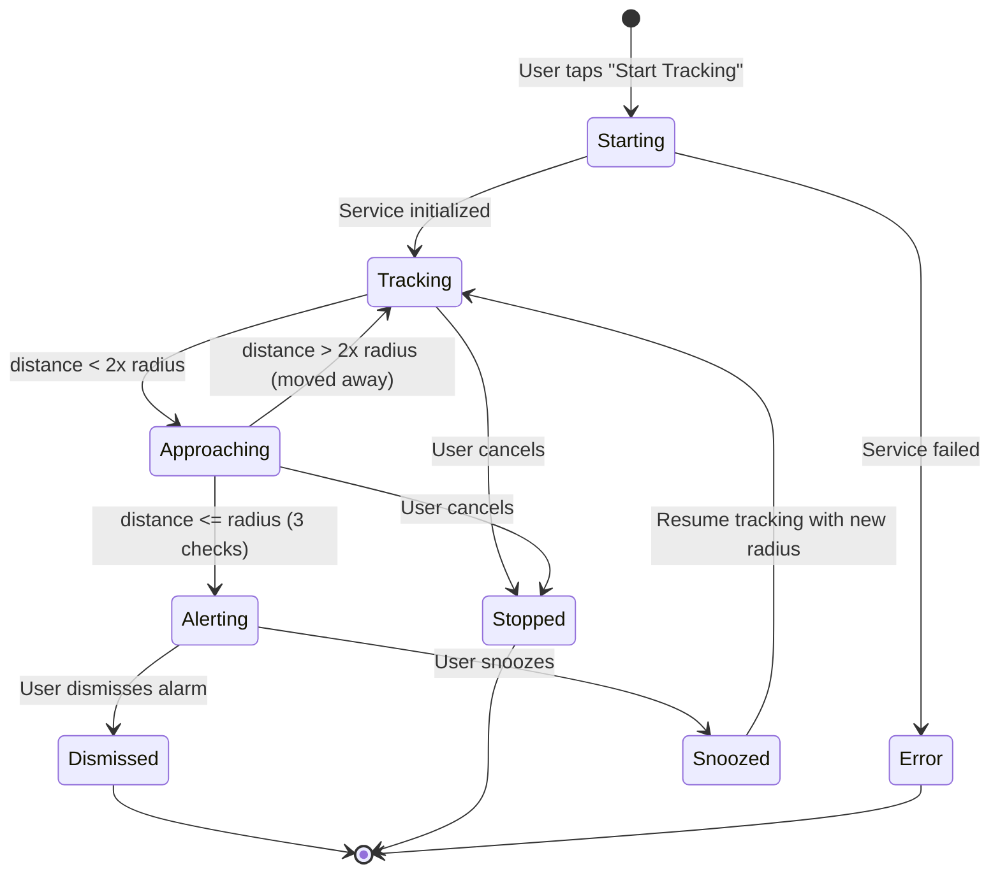

# Phase 09 — Active Trip Screen

> **Goal:** Build the primary "in-trip" screen that shows real-time distance, a live map tracking the user's position, trip controls, and smooth transitions between tracking states (tracking → approaching → alerting).  
> **Dependencies:** Phase 07 (tracking), Phase 08 (alert trigger)  
> **Deliverable:** Full trip lifecycle visible — from start to alarm to dismissal.

---

## 9.1 — Screen States

### 9.1.1 State Transitions



### 9.1.2 Visual State Mapping

| State | Background | Distance Color | Status Badge | CTA Button |
|-------|------------|----------------|-------------|------------|
| `tracking` | Normal (dark/light) | Primary | 🟢 "Tracking" | "Cancel Trip" |
| `approaching` | Subtle amber tint | Amber pulsing | 🟡 "Approaching" | "Cancel Trip" |
| `alerting` | Alert gradient (full screen) | Red pulsing | 🔴 "ARRIVING!" | "Dismiss" slider |
| `stopped` | Normal | Muted | ⚪ "Stopped" | "Back to Home" |
| `error` | Normal | Muted | 🔴 "Error" | "Retry" |

---

## 9.2 — Tracking Screen Layout

### 9.2.1 Main Layout — `lib/features/tracking/presentation/active_trip_screen.dart`

```
┌──────────────────────────────────────────────────┐
│                                                  │
│  ┌──────────────────────────────────────────┐    │
│  │                                          │    │
│  │              [LIVE MAP]                  │    │  ← 60% of screen height
│  │                                          │    │
│  │     ● ← Current location (blue dot)     │    │
│  │     · · · · breadcrumb trail            │    │
│  │                                          │    │
│  │                    📍 ← Destination pin  │    │
│  │                 ◯ ← Alert radius circle  │    │
│  │                                          │    │
│  └──────────────────────────────────────────┘    │
│                                                  │
│  ┌──────────────────────────────────────────┐    │
│  │  ─── (drag handle) ───                   │    │  ← Draggable bottom panel
│  │                                          │    │
│  │  📍 Aluva Metro Station                  │    │
│  │  🟢 Tracking                             │    │
│  │                                          │    │
│  │          ╔════════════════╗               │    │
│  │          ║    4.2 km      ║               │    │  ← Hero distance
│  │          ║   remaining    ║               │    │
│  │          ╚════════════════╝               │    │
│  │                                          │    │
│  │  ┌─────────────┬────────────────────┐    │    │
│  │  │ Alert at     │ ETA               │    │    │
│  │  │ 500m         │ ~12 min           │    │    │
│  │  └─────────────┴────────────────────┘    │    │
│  │                                          │    │
│  │  ┌──────────────────────────────────┐    │    │
│  │  │   🔴 Cancel Trip                  │    │    │
│  │  └──────────────────────────────────┘    │    │
│  │                                          │    │
│  └──────────────────────────────────────────┘    │
│                                                  │
└──────────────────────────────────────────────────┘
```

---

## 9.3 — Distance Display Widget

### 9.3.1 Animated Distance Counter — `lib/features/tracking/presentation/widgets/distance_display.dart`

```dart
class DistanceDisplay extends ConsumerWidget {
  // Features:
  // - Large hero number (distanceHero style, 56px)
  // - Animated number transition (old value → new value)
  // - Unit label below ("km" or "m")
  // - Color changes based on proximity:
  //   - Normal (> 2x radius): Primary text color
  //   - Approaching (< 2x radius): Amber with pulse
  //   - Critical (< radius): Red with faster pulse
  // - Smooth 500ms animation between values
}
```

```dart
class AnimatedDistanceCounter extends StatefulWidget {
  final double distanceMeters;
  final Color color;

  @override
  State<AnimatedDistanceCounter> createState() => _AnimatedDistanceCounterState();
}

class _AnimatedDistanceCounterState extends State<AnimatedDistanceCounter>
    with SingleTickerProviderStateMixin {
  late AnimationController _controller;
  late Animation<double> _animation;
  double _previousValue = 0;

  @override
  void didUpdateWidget(AnimatedDistanceCounter oldWidget) {
    super.didUpdateWidget(oldWidget);
    if (oldWidget.distanceMeters != widget.distanceMeters) {
      _previousValue = oldWidget.distanceMeters;
      _controller.forward(from: 0);
    }
  }

  @override
  Widget build(BuildContext context) {
    return AnimatedBuilder(
      animation: _animation,
      builder: (context, child) {
        final current = _previousValue +
          (_animation.value * (widget.distanceMeters - _previousValue));

        final formatted = _formatDistance(current);
        return Column(
          children: [
            Text(
              formatted.value,
              style: AppTypography.distanceHero.copyWith(color: widget.color),
            ),
            Text(
              formatted.unit,
              style: AppTypography.distanceUnit.copyWith(color: widget.color.withOpacity(0.7)),
            ),
          ],
        );
      },
    );
  }
}
```

---

## 9.4 — Trip Map View

### 9.4.1 Live Map Widget — `lib/features/tracking/presentation/widgets/trip_map_view.dart`

```dart
class TripMapView extends ConsumerWidget {
  // Features:
  // - Shows current location (blue pulsing dot)
  // - Shows destination pin (red marker)
  // - Shows alert radius circle (translucent purple)
  // - Shows breadcrumb trail (dotted purple line)
  // - Auto-follows user position (smooth pan)
  // - Fits both markers in view when appropriate
  // - Zoom level adjusts based on distance:
  //   - > 10km: zoom 10
  //   - 5-10km: zoom 12
  //   - 1-5km: zoom 14
  //   - < 1km: zoom 16
  //   - < 500m: zoom 17 (approaching mode)
}
```

### 9.4.2 Auto-Fit Bounds
When both user and destination are visible, fit the map to show both:

```dart
void fitBounds(LatLng userPos, LatLng destPos) {
  final bounds = LatLngBounds.fromPoints([userPos, destPos]);
  _mapController.fitBounds(
    bounds,
    options: const FitBoundsOptions(
      padding: EdgeInsets.all(50),
      maxZoom: 16,
    ),
  );
}
```

---

## 9.5 — Trip Info Panel

### 9.5.1 Info Grid — `lib/features/tracking/presentation/widgets/trip_info_panel.dart`

```
┌─────────────┬────────────────────┐
│ Alert at     │ ETA               │
│ 500m ●       │ ~12 min           │
├─────────────┼────────────────────┤
│ Speed        │ Tracking for      │
│ 45 km/h      │ 32 min            │
├─────────────┼────────────────────┤
│ GPS Signal   │ Battery           │
│ ●●●●○ Good   │ 78% 🔋            │
└─────────────┴────────────────────┘
```

### 9.5.2 Data Sources

| Field | Source | Update Frequency |
|-------|--------|-----------------|
| Distance | Haversine calc | Every GPS update |
| ETA | `distance / currentSpeed` | Every GPS update |
| Speed | `position.speed` (m/s → km/h) | Every GPS update |
| Tracking duration | `DateTime.now() - tripStartTime` | Every second (Timer) |
| GPS Signal | `position.accuracy` mapped to bars | Every GPS update |
| Battery | `battery_plus` package | Every 30 seconds |

### 9.5.3 ETA Calculation

```dart
String formatETA(double? distanceM, double? speedMs) {
  if (distanceM == null || speedMs == null || speedMs <= 0.5) {
    return '--';  // Stationary or no data
  }

  final seconds = distanceM / speedMs;
  final duration = Duration(seconds: seconds.round());

  if (duration.inHours > 0) {
    return '~${duration.inHours}h ${duration.inMinutes % 60}min';
  } else if (duration.inMinutes > 0) {
    return '~${duration.inMinutes} min';
  } else {
    return '<1 min';
  }
}
```

---

## 9.6 — Approaching State

### 9.6.1 Visual Changes When Approaching
When `distance < 2 * alertRadius`:

```dart
// 1. Status badge changes to amber "Approaching"
// 2. Distance text starts pulsing amber
// 3. Map zooms in closer
// 4. Subtle amber border glow on bottom panel
// 5. Haptic feedback pulse every 30 seconds
```

### 9.6.2 Approaching Notification Update
```
┌──────────────────────────────────┐
│ ⚡ Approaching Aluva Metro       │
│    820m away - Get ready!        │
│    [Stop Tracking]               │
└──────────────────────────────────┘
```

---

## 9.7 — Cancel Trip Flow

### 9.7.1 Confirmation Dialog

```
┌─────────────────────────────────┐
│       Cancel This Trip?         │
│                                 │
│  Your destination alert will    │
│  be cancelled and tracking      │
│  will stop.                     │
│                                 │
│  ┌─────────────────────────┐    │
│  │   Yes, Cancel Trip       │    │  ← Danger button
│  └─────────────────────────┘    │
│                                 │
│        Keep Tracking            │    │  ← Ghost button
└─────────────────────────────────┘
```

### 9.7.2 On Cancel:
1. Stop foreground service
2. Stop GPS tracking
3. Remove persistent notification
4. Navigate back to Home Screen
5. Show snackbar: "Trip cancelled"

---

## 9.8 — Trip Completion Flow

### 9.8.1 After Alarm Dismissal
When user dismisses the alarm:

```
┌──────────────────────────────────────────┐
│                                          │
│         🎉                               │
│                                          │
│    You've Arrived!                       │
│                                          │
│    📍 Aluva Metro Station                │
│                                          │
│    Trip Duration: 47 minutes             │
│    Distance Traveled: ~45 km            │
│                                          │
│                                          │
│    ┌──────────────────────────────┐      │
│    │   🏠 Back to Home            │      │
│    └──────────────────────────────┘      │
│                                          │
│         Save to History                  │
│                                          │
└──────────────────────────────────────────┘
```

---

## 9.9 — Navigation & Screen Management

### 9.9.1 Screen Flow with Navigation

```dart
// Route management for active trip
// Use named routes or GoRouter for clean navigation

// Home → Destination Search → Alert Config → Active Trip → (Alarm) → Completed
// Active Trip is a "modal" screen — back button shows cancel confirmation
// Alarm screen is pushed on top of Active Trip (full-screen overlay)

class AppRouter {
  static const String home = '/';
  static const String destinationSearch = '/search';
  static const String alertConfig = '/config';
  static const String activeTrip = '/trip';
  static const String alarm = '/alarm';
  static const String completed = '/completed';
  static const String settings = '/settings';
  static const String history = '/history';
}
```

### 9.9.2 Back Button Behavior
- **Active Trip Screen:** Back button → "Cancel trip?" confirmation
- **Alarm Screen:** Back button disabled → must slide to dismiss
- **Other screens:** Normal back navigation

---

## 9.10 — Testing

### 9.10.1 Unit Tests
- [ ] `AnimatedDistanceCounter` transitions between values
- [ ] `formatETA` calculates correctly (1000m at 10m/s = "~2 min")
- [ ] `formatETA` handles stationary case (speed 0)
- [ ] GPS signal bars mapping (accuracy 5m = 5 bars, 50m = 3 bars, 100m = 1 bar)

### 9.10.2 Widget Tests
- [ ] Active trip screen shows destination name
- [ ] Distance display updates when state changes
- [ ] Status badge shows correct color and text per state
- [ ] Cancel button shows confirmation dialog
- [ ] Confirmation dialog cancel returns to trip screen
- [ ] Confirmation dialog confirm navigates to home
- [ ] Approaching state shows amber styling

### 9.10.3 Integration Tests (Physical Device)
- [ ] Start trip → active trip screen shows with map
- [ ] Walk → distance updates in real-time
- [ ] Approach test destination → state changes to "Approaching"
- [ ] Enter radius → alarm triggers → alarm screen shows
- [ ] Dismiss alarm → completion screen shows
- [ ] Cancel trip from active trip → returns to home
- [ ] Rotate device → layout adjusts (if supported)

---

## ✅ Phase 09 — Acceptance Criteria

| # | Criterion | How to Verify |
|---|-----------|---------------|
| 1 | Map shows user + destination | Both markers visible |
| 2 | Distance updates in real-time | Number changes every 3-5s |
| 3 | ETA shows reasonable estimate | Compare with maps app |
| 4 | Approaching state triggers | Enter 2x radius → amber UI |
| 5 | Breadcrumb trail draws | Route path visible on map |
| 6 | Cancel shows confirmation | Tap cancel → dialog appears |
| 7 | Trip completion screen shows | After alarm dismiss → completion visible |
| 8 | Speed display works | Moving → speed shown, stationary → "0 km/h" |
| 9 | GPS signal indicator works | Good signal → 4-5 bars, poor → 1-2 bars |
| 10 | Back button is guarded | Can't accidentally leave trip |

---

## ⚠️ Common Pitfalls

| Issue | Solution |
|-------|----------|
| Distance counter animation jitters | Use `CurvedAnimation` with `Curves.easeOutCubic` |
| Map re-renders cause jank | Use `RepaintBoundary` around map widget |
| ETA shows infinity when stationary | Guard with `speed > 0.5 m/s` check |
| Bottom panel overlaps map | Use proper `Stack` layout or `DraggableScrollableSheet` |
| Map doesn't update position smoothly | Use animated camera moves, not instant `move()` |
